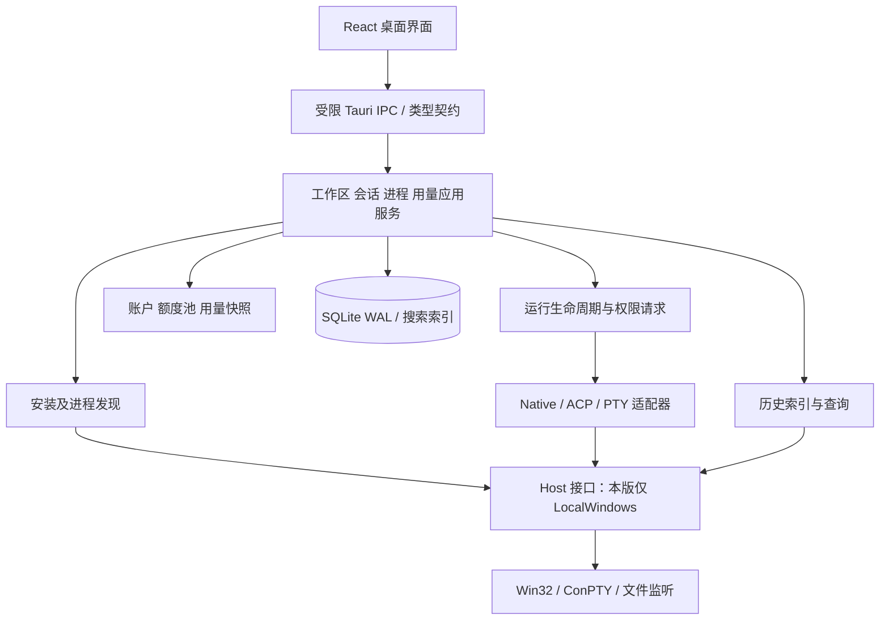

# MultiCLI 产品与技术方案

## 1. 建议结论

采用 **Desktop CC GUI 的固定版本作为首选派生底座，Tauri 2 + React/TypeScript + Rust/Tokio + SQLite + xterm.js/ConPTY**。增加独立的全局发现、双向索引、账户额度与 Host 边界；其他开源项目按模块参考，不合并多个桌面壳。

这延续原对话的主要选型，但增加 S00 基线准入：上游有实现不等于在用户 Windows 上可用。若不能通过构建、PTY、引擎边界和本地隔离验证，Sol 按预设退路建立同栈小型骨架，选择性移植经过确认的模块；不得连续几阶段修上游无关功能。判断规则见 S00。

当前已读上游 package.json、Cargo.toml 和引擎目录，确认其存在 CodeBuddy、Codex app-server、Claude 适配文件及 portable-pty、SQLite、Windows API 依赖；没有编译、实测或完成源码审计。[源码入口](https://github.com/zhukunpenglinyutong/desktop-cc-gui/tree/main/src-tauri/src/engine)

## 2. 产品范围与交互

第一版面向 Windows 11 x64、普通用户权限、原生 Windows CLI；Git Bash 可以是某个 CLI 的依赖，但不以 WSL、Docker、Linux 服务为前提。Windows ARM64、WSL 内进程、其他系统列入后续。

“纯本地”指工作台、索引、终端及管理服务在本机运行，不建云端控制服务；用户使用的 CLI 仍会按原登录和配置访问各自模型服务。

导航：总览 / 工作区 / Agents / 全部会话 / 进程 / 用量 / 设置。

- 工作区 → Agent → 会话，与 Agent → 工作区 → 会话访问同一 Session；不得复制两套记录。
- 会话详情：结构化聊天、工具执行、关联终端、运行与来源信息。无结构化能力时明确呈现终端或原始记录，不伪造聊天。
- 工作区支持普通文件夹和 Git worktree；工作区级聚合、同仓库分组与实际执行目录分开。
- 进程页面显示来源程序、进程树、可确认的工作区、会话关联证据。无法得知的目录或任务状态显示“未知”。
- 总览以待处理输入、运行会话、最近活动为主，不做无证据的“工作效率评分”。
- UI 以中文为默认；中文路径、中文输入法、复制粘贴、键盘导航、125%/150% 缩放属于正式验收。

### 第一版必须交付

| 编号 | 需求 | 完成定义 |
|---|---|---|
| R01 | 双向查看 | 同一会话可从 Agent 与工作区进入，计数一致 |
| R02 | 外部发现 | 普通用户可访问的已支持 CLI 进程自动出现，不依赖从工作台启动 |
| R03 | 历史 | Codex、Claude Code、CodeBuddy 的支持版本历史可索引、搜索与查看；格式限制可见 |
| R04 | 交互 | 三款核心 CLI 能在工作台新建、发消息、处理权限、取消；所有受支持可执行入口可走 PTY |
| R05 | 继续历史 | 三款核心 CLI 的已验证版本支持官方方式继续会话；明确区分加载与继续执行 |
| R06 | 额度 | Codex 官方额度接入；Claude 与 CodeBuddy 提供已验证官方入口及真实可得用量；不可读字段不得估算为余额 |
| R07 | 主流覆盖 | 首批 9 个产品族有版本化安装/进程识别规则；能力按实测逐项声明 |
| R08 | 本地可靠 | 数据隔离、停止进程有所有权边界、历史文件只读、安装包可用 |
| R09 | 扩展能力 | Host、Adapter、HistoryParser、UsageProvider 接口，远程实现为零 |

第一版不包含：跨机器连接、云同步、多人权限、CLI 安装商店、自动更新所有 CLI、模型自动选路、跨 Agent 自动委派、自研代码编辑器、完整 Git GUI、插件市场、网页远控、任意外部终端强行接管。已有上游的非目标功能从产品入口和后台启用点关闭，不以新开发任务扩大范围。

### 三种来源与能力

| 来源 | 可承诺 | 不自动承诺 |
|---|---|---|
| 工作台启动 managed | 管理所持有进程/协议连接，收发消息或 PTY 输入输出 | CLI 不提供的历史、余额、状态语义 |
| 外部发现 external-observed | 识别、进程存活、可读元信息、历史关联 | 接管 stdin/stdout、完整终端画面、准确等待状态 |
| 已有历史 history-only | 查看与检索，能力支持时新开进程继续 | 原进程仍存活、历史完整、可以无冲突接续 |

来源与协议是两个字段，不能把 ACP 当作所有权类型。协议可以是 native / acp / pty；运行状态、交互状态也必须分离。Windows ConPTY 的输入输出管道由创建它的宿主持有，因此本方案不把外部终端接管列为通用能力。[Microsoft ConPTY 文档](https://learn.microsoft.com/en-us/windows/console/creating-a-pseudoconsole-session)

## 3. 技术架构



前端不拼接系统命令，不直接访问 CLI 配置和凭据。后端提供有类型的命令和事件，未知字段允许保留、未知方法返回 unsupported。进程枚举、文件解析、数据库写入与 UI 分离；阻塞 OS 操作使用专用线程或 spawn_blocking。

| 部分 | 首选 | 实施约束 |
|---|---|---|
| 桌面/UI | Tauri 2、React、TypeScript、Zustand、现有样式体系 | 沿用底座锁文件，不为追新升级主版本 |
| 终端 | xterm.js、portable-pty 的 Windows ConPTY 后端 | 大输出限流、按终端隔离、隐藏终端仍排空输出 |
| OS | windows crate + sysinfo，命令行不足时补 WMI/CIM | 禁止常驻管理员权限，拒绝访问是正常降级 |
| 数据 | rusqlite、WAL、单写队列、迁移版本 | 外部历史源与自有数据库严格分离 |
| 搜索 | FTS5，验证 trigram 中文子串方案 | 不假设默认分词适合中文；短词使用受限回退查询 |
| 监测 | notify 类文件监听 + 周期补扫 | 监听事件可丢失，不能作为唯一正确性来源 |
| 测试 | Rust tests、Vitest、契约/fixture、真实 Windows 桌面烟测 | 浏览器 mock 测试不替代 Tauri/ConPTY 验收 |
| 打包 | Tauri NSIS 用户级安装包 | 优先一条 Windows x64 路线，不同时做多安装器 |

S00 对照实际 Cargo.lock/pnpm-lock 固定工具链。当前上游清单可见 React 18.3.1、pnpm 10.29.3、Rust 最低 1.90 和 Tauri 2；它们是查证快照，不是未来永远适用的版本要求。[package.json](https://github.com/zhukunpenglinyutong/desktop-cc-gui/blob/main/package.json) · [Cargo.toml](https://github.com/zhukunpenglinyutong/desktop-cc-gui/blob/main/src-tauri/Cargo.toml)

## 4. 数据模型

逻辑结构由 Sol 在 S00 转成 SQL 与 IPC Schema，S01 实现。不要再用一个 sessions 表里的 PID 同时表示历史、进程和执行轮次。

| 对象 | 关键字段与约束 |
|---|---|
| Host | id、kind、path_style；本版仅 local-windows |
| AgentDefinition | 稳定产品 id、厂商、特征版本、候选安装入口、官方来源 |
| AgentInstallation | host_id、agent_id、canonical executable、version、config_profile_id；一产品可多安装 |
| Workspace | host_id、display_path、canonical_path、repo_group_id、worktree 信息；同目录别名不重复 |
| Session | 内部 id、agent_id、host_id、source_namespace、native_id、origin、title；原生 id 在来源命名空间内唯一 |
| SessionWorkspace | session_id、workspace_id、role、evidence；一会话可涉及多个目录，有主执行目录 |
| Run | id、session_id、installation_id、transport、ownership、started_at、ended_at、execution_status |
| ProcessObservation | host_id + pid + creation_time 组合身份、ppid、parent_creation_time、executable、redacted_command、observed_at |
| RunProcessLink | run_id、process_identity、link_kind、evidence；一 Run 可多进程 |
| SessionRelation | parent/child、kind=os-parent或explicit-delegation或inferred、confidence、evidence |
| Message/Event | session_id、run_id可空、native_event_id、seq、kind、内容、source_ref、observed_at |
| HistorySource/Cursor | host、profile、原生路径、file_identity、size、offset、parser_version、尾部残片 |
| AccountProfile | provider、官方身份或用户别名、auth_mode、可得计划信息；不存 token |
| QuotaPool/Snapshot | account、provider pool id、window、used/remaining、unit、reset_at、source、fetched_at、stale/error |
| UsageSample | session/run/account可空、model、input/output/cache tokens、cost、currency、计费/估算属性、去重键 |

Windows 路径通过本机策略正规化，保留显示路径；不可简单对所有未来 Host 路径小写。丢失目录、权限不足、网络盘不响应各自处理；扫描默认不追踪重解析点递归。SQLite 的索引是派生数据，用户备注/标签是自有数据，重建索引时不能删除后者。

会话恢复创建新 Run，继续关联同一 Session。协议事件与历史文件可能描述同一消息，按原生事件 id 或稳定来源键去重；不要直接把两份 token 相加。

## 5. 核心接口与状态

```text
HostBackend: listProcesses / inspectProcess / resolveExecutable / spawn / watchFiles
RuntimeAdapter: probeCapabilities / start / send / cancelTurn / answerPermission / resume / stop
HistoryParser: discoverSources / parseIncremental / normalize / resolveResumeTarget
UsageProvider: identifyAccount / fetchQuota / readUsage / officialUsageEntry
TerminalBackend: create / write / resize / subscribeOutput / close
```

能力是集合而非线性 L1–L4：installedDetection、processDetection、historyRead、historySearch、resume、structuredChat、permissionFlow、pty、quotaRead。每个能力记录 supported / unsupported / unverified，支持版本、证据、失败原因和最近验证时间。历史能力与终端能力可以独立存在。

运行状态：starting / running / stopping / exited / failed / unknown。交互状态：working / awaiting-permission / awaiting-input / idle / unknown；后者带 observed / inferred 证据级别。CPU 低、无输出、窗口标题都不能单独证明 Agent 正在等待输入。

统一事件至少带 schema_version、session_id、run_id、stream_id、seq、timestamp、kind、source。处理乱序、重放、重复、未知事件、断开和取消竞态。权限请求有唯一 request_id、目标 Run、允许的选项、失效状态；UI 只允许回复当前有效请求，默认不自动批准。这里是成品应用的权限设计，与施工 Agent 的工具权限无关。

同一原生会话继续前检查本工作台的写入租约及已知外部活跃关联；拒绝确定冲突。外部关联不完整时提示状态不确定，不宣传跨所有程序的强互斥保障。查看历史不会自动 resume 或发送任何 prompt。

## 6. 全局发现

按已知入口检查 PATH、安装管理器落盘的已知目录、用户自定义路径、已知历史根目录；不遍历整个磁盘，不自动执行扫描到的任意脚本。版本探测仅对已经匹配的明确可执行入口运行带超时的官方 version/help 命令；历史残留不等于“当前已安装”。

进程快照建议默认 3 秒，后台退至 10 秒；版本探测缓存，不在每次进程轮询启动 PowerShell。WMI 优先批量查询并缓存静态信息。每次快照失败保留最近状态且标陈旧，不能把全体进程标为退出。

规则组合：二进制路径/包元信息 + argv 入口特征 + 已知包装器关系；不能因为 node.exe、python.exe 或任意参数里出现 codex 就判定产品。npm .cmd/.ps1 包装器、原生 exe、同产品多版本均需样本。

父 PID 结合创建时间验证，父进程已经退出就标断链。外部进程当前工作目录没有通用可靠查询保证，优先 CLI 元数据、启动参数和历史；不通过未文档化内存读取强行推断。无法确定工作区时放“未关联”，提供人工绑定。

Agent 内部再次启动 CLI 的场景要覆盖。进程父子关系只能代表 OS 关系；显式协作元信息才可标“任务委派”。环境变量关联标识只用于本工作台创建的子进程，不全局写用户环境，也不保证第三方 CLI 一定继承。

## 7. 历史与终端

历史源只读，通过选择来源目录开启索引；默认已知根目录，不读取无关凭据。解析器限定大小、深度和时间预算。JSONL 半行暂存，完整行再提交；文件缩小/替换/移动触发校验；坏行隔离而不是整批丢弃。SQLite 型来源采用正确的只读连接/一致性读取，不直接复制一个正在写入的主文件忽略 WAL。

本地索引可能包含用户会话内容：提供来源范围、清理索引、保留策略和诊断导出预览。原始历史、运行日志、真实测试录音录像与账号文件不进 GitHub；公开 fixture 必须合成或人工去敏。Markdown/HTML/链接、终端 OSC 控制内容都按不可信数据处理。

PTY 输入通过参数数组和已审查包装器启动，不拼接不可信 shell 字符串。专门验证含空格、中文、引号、&、括号的路径和参数。输出采用有界缓冲与背压；日志达到上限轮转并明确截断，不能让长输出耗尽内存。

首版生命周期选择：关闭窗口默认进入托盘，进程仍由同一个应用实例持有；显式退出显示正在运行的会话并选择取消退出或停止托管运行后退出。应用崩溃时托管 Job Object 负责清理，本版不承诺崩溃后保活；重启只恢复历史和布局，CLI 继续执行必须显式操作。**托盘隐藏不等于后台终端持久化**。

psmux 作为 v1.1 可选 TerminalBackend，在单独验证句柄、重连、输出重放和退出语义后接入；本版不同时实现自研 daemon 与 psmux。[参考实现](https://github.com/izll/agent-session-manager-desktop)

## 8. CLI 支持矩阵

“主流”按用户实际需求、真实 CLI 产品、官方维护与 Windows 路线选择，不采用未经确认的星数排名。以下是施工目标，不是现有兼容性声明。

| 产品族 | 首版目标 | 原则 |
|---|---|---|
| Codex CLI | 发现 + 历史 + 继续 + 原生结构化 + PTY + 官方额度 | app-server 路线优先，按实际 schema 握手 |
| Claude Code | 发现 + 历史 + 继续 + 原生结构化 + PTY + 用量入口 | 复用 CLI 既有认证，验证结构化权限往返 |
| CodeBuddy Code | 发现 + 历史 + 继续 + ACP 结构化 + PTY + Token 用量 | 官方 codebuddy --acp；不依赖猜测内部接口 |
| Gemini CLI | 安装/进程识别 + PTY，发现已有历史来源 | 结构化历史列后续；/stats model 数据视版本 |
| OpenCode | 安装/进程识别 + PTY | v1/v2 同名命令分别建版本规则 |
| Qwen Code | 安装/进程识别 + PTY | 官方 Windows 入口，独立 profile |
| GitHub Copilot CLI | 安装/进程识别 + PTY | 不把旧 gh 扩展当同一可执行产品 |
| Kimi Code CLI | 安装/进程识别 + PTY | 新旧 Kimi CLI 分开，旧版标 legacy |
| Aider | 安装/进程识别 + PTY | Python/uv/pipx 包装器识别 |

TRAE/trae-agent/用户实际 traecli、Cursor CLI、Goose、Crush、Pi、DSH 为增补候选；S00 优先调查用户提到的 TRAE 实际安装。确认有原生 Windows CLI 后补规则；若只有 IDE 或 Linux/WSL 入口，则显示明确限制，不能因名称相似就宣称兼容。DSH 是 CLI/运行宿主候选，DeepSeek 是模型/本项目开发角色，两者不得混为一谈。

提供“自定义 CLI”配置：用户选择可执行文件、参数数组、默认目录和可选环境差量，走通用 PTY；不自动授予历史、额度或结构化能力。这保证未进入特征库的新工具仍可在工作台使用，但不会被误标为已自动识别。

首批 9 族识别规则均需正负 fixture；P0 三款必须真机端到端，P1 若本机未安装只能记“规则验证通过，真机 NOT_RUN”，不能宣称已完全支持。首版 Beta 至少另外两款 P1 真机通过，其余在兼容性表显示实测覆盖；安装缺失不允许临时伪造通过。稳定版再补齐对外承诺的所有 PTY 真机验证。

Kimi 旧仓库已声明迁移到 Kimi Code；OpenCode 文档也明确 v1/v2 默认共用命令名。这说明规则必须绑定产品版本，不能把旧安装说明永久固化。[Kimi 变更记录](https://github.com/MoonshotAI/kimi-cli/blob/main/CHANGELOG.md) · [OpenCode 文档](https://opencode.ai/docs/)

## 9. 额度与账户

必须区分：官方额度池、API 账单、CLI 报告 token、本地估算。Quota 是账户池，不是进程资源；多个 Session 不累加“剩余额度”。缺少官方账户 id 时保持独立未确认 profile，允许用户显式确认合并，不通过相同邮箱文本或 CLI 路径猜账号。

| 产品 | 本次查证 | 首版做法 |
|---|---|---|
| Codex | 官方 app-server 有 account/rateLimits/read 与更新事件 | 从 CLI 协议读取真实窗口、已用比例、重置时刻；未登录/不适用/请求失败分开 |
| Claude Code | 官方 /usage 有订阅条与会话 token/成本 | 优先已公开、版本匹配的可机器读取路线；否则用户手动打开官方 CLI /usage 或官方页面，不向忙碌会话自动注入命令 |
| CodeBuddy | 官方 /cost 提供会话 token；ACP 存在 | 读取明确事件用量；本次未确认可公开调用的订阅积分余额接口，余额显示“不可读取”并提供官方入口 |
| Gemini | /stats model 显示 token 与 quota 信息 | 验证是否有稳定机器出口；否则给出官方命令入口，不承诺自动后台额度 |

来源：[Codex 协议](https://learn.chatgpt.com/docs/app-server) · [Claude 用量](https://code.claude.com/docs/en/costs) · [CodeBuddy 成本](https://www.codebuddy.cn/docs/cli/costs) · [Gemini 命令](https://geminicli.com/docs/reference/commands/)。

每张卡必须包含来源、账户别名、单位、抓取时间、重置时刻、陈旧/失败状态。刷新默认 5 分钟并有退避，禁止每秒轮询或持续启动 CLI。读取额度不触发推理、自动充值、兑换额度、修改套餐或向管理员发通知。

费用没有可靠价格表或官方账单时留空；有价格表则标“估算”与版本，不用 token 推算订阅余额。API key、Cookie 不进入 SQLite；首版不自建账号登录器、不扫描浏览器 cookie，优先让 CLI 自己管理认证。

## 10. 远程预留

HostId、HostPath、运行/文件操作边界从第一版存在；本地协议不暴露 Rust 进程句柄给 UI。未来可接 RemoteHost + SSH tunnel + daemon，但本版只有类型和 mock 契约测试，不开 SSH 端口、不部署远程组件、不增加空壳远程设置页。

## 11. 路线与工作量

S00–S03 形成只读预览版：发现与历史可用。S04–S05 形成交互 Alpha：三款核心 CLI 可操作。S06–S07 形成个人 Beta：额度、扩展识别、安装与质量门通过。v1.1 才考虑 psmux 与更多结构化适配；远程属于另一期。

预计 8 个阶段、约 18–26 个小批次回交。工作量配比建议：环境/基线 10%，模型导航 10%，发现 15%，历史 15%，终端 15%，三核心协议 20%，额度与扩展 8%，发布 7%。这是规划分配，不是已测工时或模型速度承诺；Sol 的独立验收贯穿每阶段。

主要不确定性：底座版本耦合、Windows CLI 包装器、外部进程信息权限、历史格式漂移、账户额度接口。以 S00/S02/S05 的实测尽早消除；失败用明确降级状态，不把缺失能力悄悄从硬验收删掉。预计保留约 25%–35% 的额外迭代余量，S00 后再用实际批次耗时估算日程。
